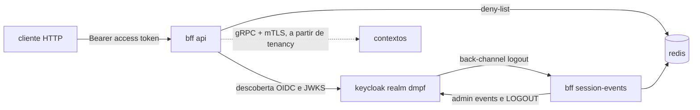

# SPEC-DXAWGZ43: Plataforma do marketplace — workspace DMPF e borda

## Resumo

Transformar o workspace herdado do template no projeto `marketplace`, pronto para
gerar bounded contexts: subir o `@mateusmacedo/dmpf-plugin` para a `1.0.0-rc.7`,
rodar o `init` com a identidade real do repositório e criar o `bff`, a borda
REST pública que autentica o usuário no Keycloak e resolve o tenant. Como
desenvolvedor do marketplace, quero gerar o primeiro contexto (`tenancy`) e
expor rotas autenticadas por tenant sem montar infraestrutura à mão.

## Contexto

- **Problema**: o `dmpf.json` ainda usa o prefixo reservado `example.com/change-me`,
  que faz o generator `bounded-context` recusar a execução. O plugin fixado
  (`1.0.0-rc.3`) está quatro versões atrás da `1.0.0-rc.7` publicada, e não há
  borda HTTP nem IdP. Nenhuma spec de contexto do roadmap pode começar.
- **Impacto**: todas as specs do MVP dependem desta (ordem 0 em `docs/roadmap.md`).
  Ao fim dela, `tenancy` começa pelo `/dmpf-new-context` e publica as próprias
  rotas no `bff`.
- **Inspiração**: o `bff` de referência do platform DMPF
  (`github.com/mateusmacedo/dmpf`, `apps/backend/bff`, commit `ddd3d0c`, o
  `workflowRef` da `1.0.0-rc.7`), que é a única borda REST/JSON da topologia de
  referência (ADR-044 do platform).
- **Decisão de base**: borda e infra seguem o DMPF, não os documentos de produto.
  As escolhas de `docs/product/` por Logto, validação de JWT no Traefik, RabbitMQ
  e GraphQL deixam de valer, assim como o Java Quarkus já tinha deixado (ADR-011).
  Os motivos estão em "Decisões técnicas" e serão registrados em uma ADR própria.
- **Links relevantes**:
  - `docs/roadmap.md` — fase MVP e ordem das specs.
  - `SPEC-XB4NCW4J` (`tenancy`) — primeiro contexto, primeira rota de contexto no `bff`.
  - `SPEC-2FJ0KYKV` (`iam`) — dona do RBAC; esta spec só autentica.
  - `docs/adr/011-template-consome-dmpf-por-versao.md` — consumo do DMPF por versão.
  - `docs/guides/primeiro-bounded-context.md` — passos `init` → contexto → gates.
  - `docs/product/Fundamentos - Conceitos White Label, Multi-Tenant e Visão Arquitetural Inicial.md`
  - `docs/product/Cross-Cutting Concerns/Cross-Cutting Concerns (Parte 2_ Fluxo de Autenticação e Autorização).md`
  - `docs/product/Cross-Cutting Concerns/Cross-Cutting Concerns (Parte 3_ Design das APIs - REST, GraphQL, CLI).md`
  - `docs/product/Cross-Cutting Concerns/Cross-Cutting Concerns Parte 4_ Comunicação Síncrona Interna com gRPC.md`
  - `docs/product/Deployment e Infraestrutura/` — Partes 1 a 3.
- **Referências externas**:
  - ADRs do platform no commit `ddd3d0c`: 044 (BFF REST e contextos gRPC), 051
    (tenant por choke point), 052 (identidade de workload), 060 (consumidor
    externo), 064 (Keycloak de referência), 065 (revogação de sessão no `authn`) e
    068 (acesso entre tenants declarado).
  - `apps/backend/bff/README.md` do platform no mesmo commit.

<constraints>
- [P0] NUNCA escrever nem editar à mão um arquivo gerenciado pelo DMPF (`dmpf.json`, `dmpf.rendered.json`, `infra/**` gerenciado, `.env.example` da raiz, `.github/workflows/dmpf-ci.yml`, ativos `dmpf-*`). Eles mudam só por `nx migrate` e `init`. Exceção: a semente `infra/local/docker-compose.yml`, que o guia manda estender.
- [P0] O `bff` DEVE resolver sujeito e tenant SÓ a partir do access token verificado pelo `authn` do kernel. Os headers `X-Subject-ID` e `X-Tenant-ID` e a query `tenant_id` NUNCA alimentam o contexto; divergência com o token é recusada com 403 `identity-mismatch`.
- [P0] Falha fechada na revogação: Redis indisponível, ou lento além de `OIDC_REVOCATION_TIMEOUT_MS`, DEVE recusar o token com 401.
- [P0] NUNCA versionar segredo. Valores de desenvolvimento só nos `*.example`, e o `.env` fica ignorado pelo git.
- [P0] NUNCA reescrever specs `done` nem ADRs históricas para trocar `nx-base-template`; elas registram o estado da época.
- [P1] O `bff` DEVE importar só o kernel DMPF (`http`, `authn`, `redis`, `observability`, `ports`, `transport` e, no middleware, os utilitários de correlação e locale do `grpc`) e a biblioteca padrão, como declara o manifesto `dmpf-units.json`.
- [P1] Todo commit desta spec sai verde: `biome ci`, `nx affected` (lint, typecheck, test, build) e os gates do DMPF aplicáveis a um workspace sem bounded context (`conformance`, `modsync`, `infrasync`). O `gate-check` e a fase de bordas do `context-check` só verificam algo a partir do primeiro contexto (ver "Decisões técnicas").
</constraints>

## Requisitos

### Funcionais

- [ ] **[P0] Upgrade do plugin para `1.0.0-rc.7`**: rodar `pnpm nx migrate @mateusmacedo/dmpf-plugin@1.0.0-rc.7`, `pnpm install` e `pnpm nx migrate --run-migrations` (migrations `sync-init` e `update-versions`).
  - O `catalog:` do `pnpm-workspace.yaml` passa a fixar `1.0.0-rc.7`, e o `minimumReleaseAgeExclude` passa a citar `@mateusmacedo/dmpf-plugin@1.0.0-rc.7` no lugar da rc.3. Se o `nx migrate` não trocar a entrada do `minimumReleaseAgeExclude`, ela é trocada à mão (o `pnpm-workspace.yaml` não é gerenciado).
  - O `go.work` passa à diretiva `go 1.26.10`, e o `@nx-go/nx-go`, à `4.0.0` (`versions.json` da rc.7).
  - O `.github/workflows/dmpf-ci.yml` passa a chamar o reutilizável no SHA `ddd3d0c4202879f168c7f6bfafaefadd94a3a621`, com `plugin-version: 1.0.0-rc.7`.
  - Se uma migration recusar um arquivo editado à mão, parar e reportar. Proibido usar `--force` sem aprovação.
  - O `migrations.json` gerado pelo `nx migrate` sai via `trash` depois das migrations.
- [ ] **[P0] `init` com a identidade do repositório**: rodar `pnpm nx g @mateusmacedo/dmpf-plugin:init --modulePrefix=github.com/mateusmacedo/marketplace --composeProject=marketplace --edge=bff --no-interactive`.
  - Valores esperados no `dmpf.json`: `modulePrefix` `github.com/mateusmacedo/marketplace`, `composeProject` `marketplace`, `imageRegistry` `ghcr.io/mateusmacedo`, `bufModule` `buf.build/mateusmacedo`, `edge` `bff`. `spiffeTrustDomain` e `composeProfile` ficam em `dmpf`, e `npmScope`, em `@mateusmacedo`.
  - O `imageRegistry` e o `bufModule` vêm do default derivado do prefixo `github.com/<owner>`. Se o `init` não os derivar sobre o valor `change-me` atual, passar `--imageRegistry=ghcr.io/mateusmacedo --bufModule=buf.build/mateusmacedo`.
  - Uma segunda execução com as mesmas opções NÃO pode alterar nenhum arquivo: o `sha256sum` de todos os arquivos do workspace (fora de `node_modules`, `.git` e `.nx`) é idêntico antes e depois dela.
- [ ] **[P0] Semente do compose local**: em `infra/local/docker-compose.yml`, trocar `name: nx-base-template-local` por `name: marketplace-local` e acrescentar `compose/keycloak.yml` à lista `include:`, que a semente atual não tem e o `init` não reescreve.
- [ ] **[P0] Renomear o pacote raiz**: trocar `@nx-base-template/source` por `@marketplace/source` e as demais menções vivas a `nx-base-template` por `marketplace` nestes arquivos: `package.json`, `project.json`, `lefthook.yml`, `.github/workflows/ci.yml`, `.github/workflows/nx-release.yml`, `.github/workflows/nx-publish-libs.yml`, `.github/workflows/publish-libs.yaml`, `.github/PULL_REQUEST_TEMPLATE.md`, `AGENTS.md`, `README.md`, `docs/onboarding.md`, `docs/guides/development-workflow.md` e `docs/guides/primeiro-bounded-context.md`.
  - `pnpm install` regenera o `pnpm-lock.yaml`.
  - Ao fim, `git grep -n "nx-base-template"` só pode retornar arquivos em `docs/specs/` com `stage: done` e em `docs/adr/` anteriores a esta spec.
- [ ] **[P0] Remover o smoke do template**: enviar `tools/template-smoke.sh` para a lixeira (`trash`) e remover o job `template-smoke` de `.github/workflows/ci.yml` e as menções em `AGENTS.md`, `README.md`, `docs/adr/README.md`, `docs/ci-cd/README.md` e `docs/guides/primeiro-bounded-context.md`.
- [ ] **[P0] App `bff` — papel `api`**: criar `apps/backend/bff` como módulo Go `github.com/mateusmacedo/marketplace/apps/backend/bff`, com binário `bff` (`cmd/main.go`).
  - A porta pública (`HTTP_ADDR`) serve só as rotas do contrato. A porta de administração (`ADMIN_ADDR`) serve `GET /livez` (204 enquanto o processo serve) e `GET /readyz` (204 enquanto serve, 503 após o `SIGTERM`), sem autenticação. Como ainda não há contexto, o `/readyz` não sonda gRPC.
  - O subcomando `bff healthcheck` consulta o `/readyz` e sai com 0 ou 1. Ele é o `HEALTHCHECK` da imagem.
  - Identidade: verificador OIDC do `authn` (`OIDC_ISSUER`, `OIDC_AUDIENCE`, `OIDC_TENANT_CLAIM=organization.*.tenant_id`) ou `AUTH_DEV_MOCK`, nunca os dois. Configuração inválida faz a partida falhar com exit 2. Se a descoberta OIDC não responder, a partida falha com exit 1.
  - Revogação: cada token aceito é consultado na deny-list do Redis (`REDIS_URL`, obrigatória). Sessão ou sujeito revogado devolve 401 com `dmpf.auth.refusal_reason` = `session_revoked`.
  - Toda rota é validada por `Route.ValidateEdge()` na partida. Uma rota que exige sujeito sem permissão declarada impede o processo de subir.
- [ ] **[P0] Rota `GET /v1/me`**: devolve `200` com `{"subject": "<sub>", "tenant": "<tenant_id>"}` lidos do contexto de execução resolvido.
  - `Requires: RequireSubjectAndTenant`, `Permission: profile`, com o contrato em `apps/backend/bff/contract/openapi/v1/openapi.yaml`.
  - Recusas: token ausente, inválido ou expirado → 401 `unauthenticated`. Token sem organização, ou com mais de uma → 403 `tenant-unresolved`. Token sem o scope `profile` → 403 `permission-denied`. Header ou query de identidade divergente do token → 403 `identity-mismatch`.
  - O corpo de erro é o `{"code", "message"}` das recusas do `bff`, com o `code` vindo do motivo do kernel `http`.
- [ ] **[P0] App `bff` — papel `session-events`**: subcomando `bff session-events`, processo à parte com uma réplica, com configuração própria (`deploy/.env.session-events.example`).
  - `POST /backchannel-logout` (`SESSION_EVENTS_ADDR`) recebe o back-channel logout do client `dmpf-portal`.
  - O polling dos admin events do Keycloak usa o client `dmpf-session-events`, a cada `OIDC_SESSION_EVENTS_INTERVAL_SECONDS`.
  - Os dois gravam na mesma deny-list que o papel `api` consulta.
  - `/livez` e `/readyz` ficam na própria porta de administração. O `/readyz` só cai para 503 no `SIGTERM`.
- [ ] **[P0] Pacote `app/rpc` em esqueleto**: o `context-check` do DMPF exige `app/config.go`, `app/wiring.go`, `app/api`, `app/rpc` e `deploy/infra.json` em toda borda. O `app/rpc` nasce só com o `doc.go` do pacote, sem cliente gRPC; os clientes chegam com cada contexto.
- [ ] **[P0] Manifesto e projeto Nx do `bff`**: `dmpf-units.json` com a unidade `bff/app` (`block` `app`, `bounded_context` `bff`, `public_integration_surface` `false`), incluindo os packages `app`, `app/api`, `app/rpc` e `cmd`.
  - `project.json` com o nome `bff` e as tags `type:app`, `scope:backend`, `stack:go`, `layer:apps`.
  - Targets do `bff`: `fmt-check`, `vet`, `build`, `test-race`, `test-infra-up`, `test-infra-down`, `test-keycloak`, `govulncheck`, `serve`, `serve-session-events`, `docker:build`, `docker:run` e `k8s-render`, sem redeclarar o que um plugin ou os `targetDefaults` já fornecem (ADR-002).
  - O `test-keycloak` sobe o Keycloak de testes (`infra/test/compose.yml`, profile `keycloak`, `127.0.0.1:18180`) e o Redis de testes, aplica o seed, roda os testes com build tag `integration` e derruba os dois ao final, mesmo com falha.
  - Os metadados (`go.mod`, `package.json`, `project.json`, `dmpf-units.json`) e a entrada `use` no `go.work` entram já adaptados no primeiro passo do `bff`, antes de qualquer target Nx rodar.
  - O baseline de conformidade (`tools/dmpf-baseline/units-baseline.json`) é regenerado pelo `conformance --write-baseline`, e a entrada `bff/app` é revisada antes do `conformance` em modo de verificação.
- [ ] **[P0] Deploy local do `bff`**: `deploy/.env.example`, `deploy/.env.session-events.example`, `deploy/compose.yml` (serviços `dmpf-bff` e `dmpf-bff-session-events`, estendendo `dmpf-http-edge` do `infra/local/compose/app-base.yml`), `deploy/infra.json` e o `Dockerfile`. O `deploy/compose.yml` entra no `include:` da semente.
  - `dmpf-bff-session-events` fica só no profile `keycloak`, porque depende do Keycloak.
- [ ] **[P1] Manifestos k8s do `bff`**: `deploy/k8s/base/` (Deployment, Service, ServiceAccount, ConfigMap, NetworkPolicy, PDB, o par do `session-events`) e `deploy/k8s/overlays/dev/`, renderizáveis pelo target `k8s-render`.
  - Overlay `deploy/k8s/overlays/hmg/` mínimo (só a `kustomization.yaml` sobre a base): o `infrasync` gera `infra/k8s/overlays/{dev,hmg}/apps/kustomization.yaml` apontando para o overlay de mesmo nome de toda app, e sem ele a referência do `hmg` fica quebrada. Ajuste de ambiente `hmg` fica fora.
- [ ] **[P1] Documentação**:
  - Criar `docs/adr/012-borda-e-infra-alinhadas-ao-dmpf.md`, que supera as escolhas de `docs/product/` por Logto, Traefik, RabbitMQ e GraphQL, e indexá-la em `docs/adr/README.md`.
  - Atualizar a seção "Apps" do `AGENTS.md` (o `bff` deixa de ser placeholder), "Decisões de base" do `docs/roadmap.md` e o `README.md` do `bff`, com a tabela de rotas, a configuração e como rodar localmente.

### Não-funcionais

- [ ] Segurança: consulta à deny-list com prazo `OIDC_REVOCATION_TIMEOUT_MS` de 250 ms (default do kernel). Estouro do prazo recusa o token.
- [ ] Segurança: todas as portas do compose local publicadas só em `127.0.0.1`, como nos arquivos gerados. O usuário ACL do Redis da deny-list fica restrito a `~dmpf:revocation:*` (verificado por um smoke: escrita fora do prefixo recusada com `NOPERM`).
- [ ] Desempenho: `GET /v1/me` com Redis local responde em menos de 50 ms no p95, medido em 100 requisições sequenciais com token válido.
- [ ] Compatibilidade: Go na diretiva `1.26.10` do `go.work`, Node `^24` e `pnpm@11.14.0`.
- [ ] Observabilidade: o papel `api` abre um span SERVER por requisição (pai no `traceparent`), menos `GET`/`HEAD` de `/livez` e `/readyz`, e exporta por OTLP para o collector do compose.

## Camadas afetadas

| Camada | Afetada? | Descrição |
|--------|----------|-----------|
| Workspace e tooling (Nx, pnpm, Go) | [x] | Plugin na rc.7, `go.work` 1.26.10, pacote raiz `@marketplace/source`, `lefthook.yml` |
| Configuração DMPF | [x] | `dmpf.json` e arquivos gerenciados reescritos pelo `init` com a identidade real e `edge: bff` |
| Borda REST (`bff/app/api`) | [x] | Rotas, middleware de identidade, saúde, `GET /v1/me` |
| Contratos | [x] | OpenAPI próprio do `bff` (`contract/openapi/v1`) |
| Domínio e aplicação de contexto | [ ] | Nenhum contexto de negócio nesta spec |
| Infra local (Compose) | [x] | Semente com `marketplace-local` e Keycloak; serviços do `bff` |
| Infra k8s | [x] | Base e overlay `dev` do `bff` |
| CI | [x] | Remoção do job `template-smoke`; `dmpf-ci.yml` passa a rodar sobre o módulo Go do `bff`, com o `gate-check` ainda reprovado até o primeiro contexto |
| Documentação | [x] | ADR-012, AGENTS.md, README, roadmap, guias |

## Localização de código

```text
marketplace/
  apps/backend/bff/
    app/
      api/                 — rotas, handlers, middleware de identidade, saúde
      rpc/doc.go           — esqueleto do pacote dos clientes gRPC (exigido pelo context-check)
      config.go            — configuração do papel api (Defaults, FromEnv, Validate)
      sessionevents.go     — wiring do papel session-events
      sessionevents_config.go
      telemetry.go         — boot de OpenTelemetry
      wiring.go            — montagem do servidor HTTP, authn e deny-list
    cmd/main.go            — binário bff (api | session-events | healthcheck)
    contract/openapi/v1/openapi.yaml — contrato de GET /v1/me
    deploy/                — .env.example, .env.session-events.example, compose.yml, infra.json, k8s/
    Dockerfile
    dmpf-units.json
    go.mod, go.sum, package.json, project.json, README.md
  docs/adr/012-borda-e-infra-alinhadas-ao-dmpf.md
```

**Arquivos a modificar**:
- `pnpm-workspace.yaml` — catálogo e `minimumReleaseAgeExclude` na rc.7 (pelo `nx migrate`).
- `dmpf.json`, `dmpf.rendered.json`, `go.work`, `nx.json`, `infra/**` gerenciado, `.env.example`, `.github/workflows/dmpf-ci.yml`, `.agents/skills/dmpf-*`, `.claude/**/dmpf-*` — só pelo `nx migrate` e pelo `init`.
- `infra/local/docker-compose.yml` — `name`, include do Keycloak e do compose do `bff`.
- `package.json`, `project.json`, `lefthook.yml`, `.github/workflows/{ci.yml,nx-release.yml,nx-publish-libs.yml,publish-libs.yaml}`, `.github/PULL_REQUEST_TEMPLATE.md` — renomeação do pacote raiz; o `ci.yml` também perde o job `template-smoke`.
- `AGENTS.md`, `README.md`, `docs/onboarding.md`, `docs/guides/development-workflow.md`, `docs/guides/primeiro-bounded-context.md`, `docs/adr/README.md`, `docs/ci-cd/README.md`, `docs/roadmap.md` — renomeação, remoção do smoke, inventário do `bff` e decisões de base.
- `tools/template-smoke.sh` — vai para a lixeira.

## Design

### Arquitetura



O `bff` não tem banco, outbox nem consumer. Os contextos do roadmap entram
como clientes gRPC do `bff` (pacote `app/rpc`) na spec de cada um, e o `edge: bff`
do `dmpf.json` já libera o `bff` no `GRPC_TRUSTED_CLIENTS` e na NetworkPolicy
deles.

### Fluxo principal (`GET /v1/me`)

1. O `otelhttp` abre o span SERVER, e o middleware lê o header `Authorization: Bearer`.
2. O `authn` verifica a assinatura pelo JWKS do Keycloak, `iss`, `aud`, `exp` e `sub`.
3. O `authn` consulta a deny-list no Redis. Sessão revogada, Redis fora ou estouro de prazo → 401.
4. `http.ResolveIdentity` resolve o tenant por `organization.*.tenant_id` e confere a permissão `profile` em `scope` e `realm_access.roles`.
5. `http.RefuseAssertedIdentity` recusa com 403 qualquer identidade enviada pelo cliente que diverja da resolvida.
6. O handler devolve `200` com `subject` e `tenant` do `ExecutionContext`.

### Ordem de execução

1. Upgrade do plugin (`nx migrate`, `install`, `--run-migrations`).
2. `init` com a identidade; semente do compose.
3. Renomeação do pacote raiz e remoção do smoke.
4. `bff`: módulo, manifesto, papéis `api` e `session-events`, rota, deploy e testes.
5. Gates do DMPF e validação do workspace; documentação e ADR-012.

### Pseudocódigo (resolução de identidade da rota)

```text
route = Route{Name: "me", Method: GET, Path: "/v1/me", ContractRef: "contract/openapi/v1/openapi.yaml#/paths/~1v1~1me/get",
              Requires: RequireSubjectAndTenant, Permission: "profile"}
on startup: route.ValidateEdge() or exit 2

handle(req):
  resolved, status, reason = http.ResolveIdentity(ctx, authenticator, route, bearer(req))
  if status != 0: return problem(status, reason)
  if status, reason = http.RefuseAssertedIdentity(req, resolved); status != 0: return problem(status, reason)
  return 200 {subject: resolved.Subject, tenant: resolved.Tenant}
```

## Decisões técnicas

- **IdP Keycloak 26.8.1 de referência**: o `init` da rc.7 já gera `infra/keycloak` e `compose/keycloak.yml`, com o realm `dmpf`, Organizations como tenant (`acme`, `globex` no seed), os clients `dmpf-portal`, `dmpf-bff` e `dmpf-session-events`, e a revogação de sessão do `authn` (ADRs 064 e 065 do platform).
  Alternativa descartada: Logto (`docs/product/`), porque perde o realm, o seed e a revogação de referência e exige integração própria fora do kernel.
- **JWT validado no `bff`, não no Traefik**: o `authn` do kernel valida o token no próprio processo e trata `X-Tenant-ID`/`X-Subject-ID` como asserção do cliente (`RefuseAssertedIdentity`).
  Alternativa descartada: Traefik injetando headers internos, porque contraria o kernel e não existe no DMPF.
- **Traefik fora do MVP**: no compose local, o `bff` publica em `127.0.0.1`, e TLS, roteamento por host e rate limit só fazem sentido com ambiente remoto, que esta spec não cobre.
- **Broker Redpanda (Kafka)**: o kernel tem adaptadores `kafka` e `sqs`, e o compose gerado sobe Redpanda.
  Alternativa descartada: RabbitMQ, porque não há adaptador no kernel.
- **GraphQL fora do MVP**: a borda do DMPF é REST com contrato OpenAPI por contexto (ADR-044 do platform), e não há suporte GraphQL no kernel.
- **Permissão `profile` em `GET /v1/me`**: o `authn` lê permissões de `scope` e `realm_access.roles` (`libs/backend/go/authn/config.go:66`, rc.7). O scope OIDC `profile` permite declarar a permissão sem editar o realm gerenciado. Os papéis de negócio ficam com o RBAC da spec de `iam`.
- **`bff` escrito sobre o de referência, sem generator**: o plugin só tem os generators `init` e `bounded-context`. O `bff` segue a estrutura do de referência no commit `ddd3d0c` e só mantém os pacotes usados. O `app/rpc` fica só como esqueleto, porque o `context-check` o exige em toda borda.
- **Gates do DMPF sem bounded context**: na rc.7, o `gate-check` reprova quando não há provider de contexto ("nenhum provider de contexto encontrado"), e o reusável do `dmpf-ci.yml` o ativa sempre que o PR toca `.golangci.yml` ou um `*dmpf-units.json`. O `context-check` encerra antes da fase de bordas quando não há contexto, então não verifica o `bff`. Os dois passam a valer na spec de `tenancy`. Esta spec aceita o `gate-check` vermelho, que já é o estado herdado do template (ADR-011).
  Alternativa descartada: mover o `bff` para a spec de `tenancy`, porque adiaria a prova de autenticação e de revogação para uma spec que já tem o primeiro contexto inteiro.
- **`spiffeTrustDomain` e `composeProfile` em `dmpf`**: renomear não traz ganho funcional e afastaria os nomes de serviço (`dmpf-grpc-api`, `dmpf-http-edge`) e o realm da referência.
- **Remoção do smoke do template**: o `tools/template-smoke.sh` exige o prefixo reservado (passo "bounded-context recusa o prefixo reservado"), que deixa de existir. A prova de ponta a ponta passa ao `dmpf-ci.yml`, que fica verde a partir do primeiro bounded context. O repositório não tem rulesets, então nenhum check obrigatório muda.

## Regras relacionadas

- `AGENTS.md` — regras duras, tags 3D, commits por projeto Nx, implementação Go pelo agente `golang-pro`.
- `.agents/skills/dmpf-bounded-context/` — forma canônica e gates do DMPF.
- `docs/nx-reference/tasks.md` — targets e grupos de release; o grupo `apps` nasce com o `bff`, se ele publicar imagem.
- `SPEC-XB4NCW4J` — consome o `bff` e o `edge`; `SPEC-2FJ0KYKV` — dona do RBAC.

## Verificação e testes

### Critérios de aceite

- [ ] `pnpm-workspace.yaml` fixa `@mateusmacedo/dmpf-plugin` em `1.0.0-rc.7` no catálogo e no `minimumReleaseAgeExclude`, sem nenhuma menção à rc.3; o `go.work` declara `go 1.26.10`; o `dmpf-ci.yml` usa o SHA `ddd3d0c4202879f168c7f6bfafaefadd94a3a621` e `plugin-version: 1.0.0-rc.7`.
- [ ] `jq '{modulePrefix,composeProject,imageRegistry,bufModule,edge}' dmpf.json` devolve exatamente `github.com/mateusmacedo/marketplace`, `marketplace`, `ghcr.io/mateusmacedo`, `buf.build/mateusmacedo` e `bff`.
- [ ] Reexecutar o `init` com as mesmas opções mantém idêntico o `sha256sum` de todos os arquivos do workspace.
- [ ] `docker compose -f infra/local/docker-compose.yml --profile keycloak config` resolve sem erro, com `name: marketplace-local`.
- [ ] `git grep -n "nx-base-template"` só retorna specs `done` e ADRs 001 a 011.
- [ ] `tools/template-smoke.sh` não existe, e `ci.yml` não tem o job `template-smoke`.
- [ ] `GET /v1/me` com token válido do usuário `alice` (seed) devolve 200 com o `subject` do token e o `tenant` da organização dela.
- [ ] Sem token → 401; token sem organização → 403 `tenant-unresolved`; `X-Tenant-ID`, `X-Subject-ID` ou query `tenant_id` divergente → 403 `identity-mismatch`.
- [ ] Depois do logout de `alice` no Keycloak, o mesmo token passa a receber 401 `session_revoked` em até `OIDC_SESSION_EVENTS_INTERVAL_SECONDS` + 1 s.
- [ ] Com o Redis parado, um token válido recebe 401 (falha fechada).
- [ ] Uma rota com sujeito e sem permissão declarada faz a partida falhar com exit 2 (teste unitário).
- [ ] Gates do DMPF aplicáveis passam localmente: `conformance` (com o baseline regenerado), `modsync --check` e `infrasync --check`.
- [ ] O `gate-check` reprova só pela ausência de provider de contexto, e o `context-check --phase structural` encerra sem contexto; nenhuma outra falha aparece nos dois.
- [ ] `pnpm nx run bff:test-race`, `pnpm nx run bff:govulncheck`, `pnpm nx run bff:test-keycloak` e `pnpm nx run bff:k8s-render` passam, e `kubectl kustomize infra/k8s/overlays/{dev,hmg}/apps` resolve sem erro.
- [ ] Validação do workspace passa: `pnpm biome ci .` e `pnpm nx affected -t lint,typecheck,test,build --exclude=@marketplace/source`.
- [ ] No PR, o `dmpf-ci.yml` só reprova no `gate-check`, pela ausência de provider de contexto; o `ci.yml` passa.

### Cenários de teste

```text
DADO o Keycloak local com o seed aplicado e o bff no profile keycloak
QUANDO alice obtém um access token com scope "openid profile" e chama GET /v1/me
ENTÃO a resposta é 200 com subject = sub do token e tenant = tenant_id da organização de alice

DADO um token válido de alice
QUANDO a requisição a GET /v1/me leva X-Tenant-ID com o tenant de outra organização
ENTÃO a resposta é 403 identity-mismatch, e o handler não é executado

DADO um token válido de um usuário sem organização (ou com duas)
QUANDO ele chama GET /v1/me
ENTÃO a resposta é 403 tenant-unresolved

DADO um token válido de alice já aceito uma vez
QUANDO alice faz logout no Keycloak e o session-events grava a revogação
ENTÃO a próxima chamada com o mesmo token recebe 401 com refusal_reason session_revoked

DADO o bff servindo e o Redis parado
QUANDO um token válido chama GET /v1/me
ENTÃO a resposta é 401, e o token não é aceito sem consulta à deny-list

DADO uma rota declarada com RequireSubject e sem Permission
QUANDO o binário bff parte
ENTÃO ValidateEdge recusa a rota, e o processo sai com exit 2
```

<critical_constraints>
- [P0] NUNCA escrever nem editar à mão um arquivo gerenciado pelo DMPF; eles mudam só por `nx migrate` e `init`. Exceção: a semente `infra/local/docker-compose.yml`.
- [P0] Sujeito e tenant vêm SÓ do token verificado pelo `authn`; identidade enviada pelo cliente e divergente é recusada com 403 `identity-mismatch`.
- [P0] Falha fechada na revogação: Redis fora ou lento recusa o token com 401.
- [P0] NUNCA versionar segredo; valores de desenvolvimento só nos `*.example`.
- [P0] NUNCA reescrever specs `done` nem ADRs históricas na renomeação.
- [P1] O `bff` importa só o kernel DMPF e a biblioteca padrão, conforme o `dmpf-units.json`.
- [P1] Todo commit sai verde: `biome ci`, `nx affected` e os gates do DMPF aplicáveis sem bounded context.
</critical_constraints>

## Escopo fora

- **Rotas de contexto no `bff` e os clientes gRPC em `app/rpc`**: entram na spec de cada contexto, começando por `SPEC-XB4NCW4J` (`tenancy`), que também deixa verdes o `gate-check` e a fase de bordas do `context-check`.
- **RBAC e papéis de negócio**: pertencem a `SPEC-2FJ0KYKV` (`iam`).
- **Traefik, TLS e roteamento por host ou subdomínio de tenant**: dependem de ambiente remoto; serão revistos com o white label da V2.
- **GraphQL e CLI administrativa**: fora do MVP; a borda do DMPF é REST.
- **Frontend e portal de login (client `dmpf-portal`)**: sem spec no backlog do MVP.
- **Kubernetes de ambientes remotos (ajustes do overlay `hmg` além do mínimo), Helm, Argo CD e IaC**: o Deployment Parte 4 não existe em `docs/product/`.
- **Rotas de plataforma com alcance entre tenants (ADR-068 do platform)**: chegam com o backoffice, que não tem spec.
- **Troca de `spiffeTrustDomain` e `composeProfile`**: decisão de manter `dmpf`.
